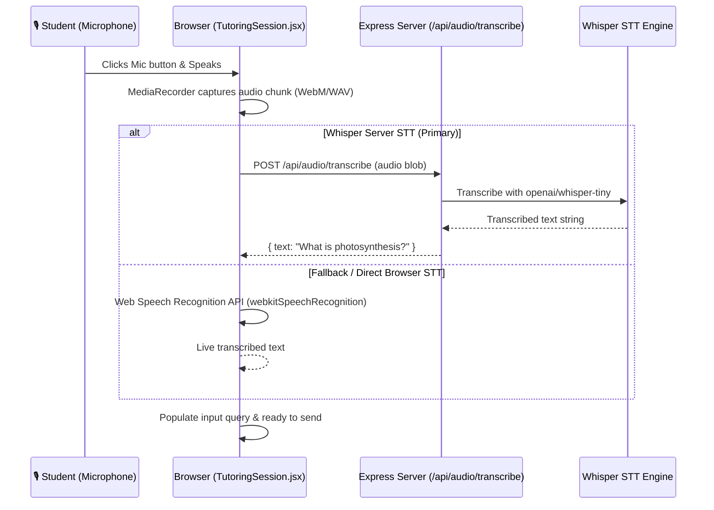

# Speech Architecture: Whisper STT & Web Speech TTS

## 1. Overview & Objective

To provide an intuitive, multimodal learning interface for young students across various grade levels (Standards 1 to 12), the tutoring system incorporates two core audio modalities:
1. **Speech-to-Text (STT)**: Enables children who are developing typing skills or prefer spoken queries to talk directly to the tutor.
2. **Text-to-Speech (TTS)**: Reads the tutor's answers aloud in a warm, child-friendly voice with clear prosody, word-pacing, and markdown cleaning.

The user specifically requested:
> *"add a proper stt and tts functionig use whispers light weight opensource api for stt"*

This document specifies the end-to-end design, model selection, API endpoints, audio processing pipeline, and frontend interaction paradigms.

---

## 2. Speech-to-Text (STT) with Whisper

### 2.1 Why OpenAI Whisper (Lightweight Open-Source)
OpenAI Whisper is an open-source, robust automatic speech recognition (ASR) system trained on 680,000 hours of multilingual, diverse speech data. It excels at recognizing diverse accents, child speech patterns, and noisy background environments.

For a responsive educational app running locally or in modest hosting environments, model footprint and latency are critical:

| Model | Parameters | Weights Size | English VRAM / RAM | Relative Speed | Suitability for Puzzle Lab |
| :--- | :--- | :--- | :--- | :--- | :--- |
| **Whisper Tiny / Tiny.en** | **39 Million** | **~75 MB** | **~150 MB** | **~32x Realtime** | **Ideal Primary Lightweight Model** |
| **Whisper Base / Base.en** | 74 Million | ~145 MB | ~300 MB | ~16x Realtime | Secondary / High Accuracy |
| Whisper Small | 244 Million | ~480 MB | ~1 GB | ~6x Realtime | Heavy for fast local inference |
| Whisper Large-v3 | 1550 Million | ~3 GB | ~6 GB | ~1x Realtime | Unsuitable for low-latency web chat |

**Selection**: We use **Whisper-Tiny** (`openai/whisper-tiny` / `openai/whisper-tiny.en`), the lightest weight open-source model available. It provides high transcription accuracy for child educational English queries while executing in milliseconds on CPU or consumer GPU.

### 2.2 Dual-Tier Hybrid Architecture

To guarantee 100% availability regardless of system setup or hardware constraints, we implement a **Dual-Tier STT Architecture**:

1. **Tier 1 (Backend Whisper STT Engine)**:
   - Endpoint: `POST /api/audio/transcribe`
   - Content-Type: `multipart/form-data` (audio file) or JSON `{ audio: "base64...", format: "webm" }`
   - Execution: Uses Python `.venv-retrieval` with `transformers` / `openai/whisper-tiny` or a fast Python worker (`server/speech/whisper_transcribe.py`).
   - Also supports optional `WHISPER_API_URL` environment variable if the user points to an external Hugging Face or Ollama/Whisper microservice.
2. **Tier 2 (Browser Native Fallback)**:
   - If the microphone stream cannot be routed to the server or if offline, the client seamlessly falls back to the browser's native `webkitSpeechRecognition` / `SpeechRecognition` API.
   - Zero configuration needed, zero latency.

---

## 3. Text-to-Speech (TTS) Engine

### 3.1 Architectural Choices
For reading tutor responses aloud to children:
- The browser-native **HTML5 SpeechSynthesis API** (`window.speechSynthesis`) is the standard, zero-dependency, zero-latency solution.
- It requires no heavy external neural TTS binaries, runs locally without network bandwidth, and works across modern browsers (Chrome, Edge, Safari, Firefox).
- It allows fine-grained runtime control over:
  - **Pitch** (slightly elevated to ~1.05 - 1.15 for a warm, engaging, friendly tutor tone).
  - **Rate / Speed** (calibrated to ~0.9 - 1.0x speed so young learners can comfortably absorb concepts).
  - **Voice Selection** (prioritizes natural English voices such as Google US English, Microsoft Jenny / Aria / Guy Natural, Samantha, or system default).

### 3.2 Markdown Stripping & Pronunciation Optimization
Assistant messages contain Markdown formatting (bold `**text**`, bullet lists, code blocks, headers `###`, and RAG citation tags like `[1]`, `[2]`). Reading these verbatim causes cognitive overload for young learners (e.g. reading aloud "bracket one bracket").

Our TTS speech preprocessor cleans text before feeding it to `speechSynthesis`:
1. Strips Markdown symbols (`#`, `*`, `_`, `` ` ``).
2. Converts citation numbers `[1]`, `[2]` into natural spoken phrasing like *"Source 1"*, *"Source 2"*, or removes them from speech.
3. Formats bullet points into brief pause breaks with comma/period pauses.
4. Breaks long paragraphs into natural phrase utterances to prevent browser buffer truncation.

### 3.3 UI Speech Controls in `TutoringSession.jsx`
- **Per-Message Listen Button**: An accessible "🔊 Listen" / "⏹️ Stop" button next to every assistant message.
- **Audio Pulse / Waveform Indicator**: Visual feedback showing that speech is actively playing.
- **Global Stop / Mute Button**: Allows learners or parents to silence speech instantly at any moment.
- **Auto-Read Toggle Option**: Especially beneficial for early elementary students (Classes 1–3) who may need hands-free auditory assistance.

---

## 4. Security & Privacy for Child Audio

- **No Voice Storage**: Audio streams captured by MediaRecorder are processed in ephemeral memory for transcription only and deleted immediately. No voice recordings or biometric voiceprints are persisted to SQLite or disk.
- **Microphone Permissions**: The browser explicitly asks the learner/guardian for microphone permission on first use.
- **CSRF & Session Scoping**: The `/api/audio/transcribe` endpoint requires valid session authentication to prevent unauthorized API scraping or abuse.
